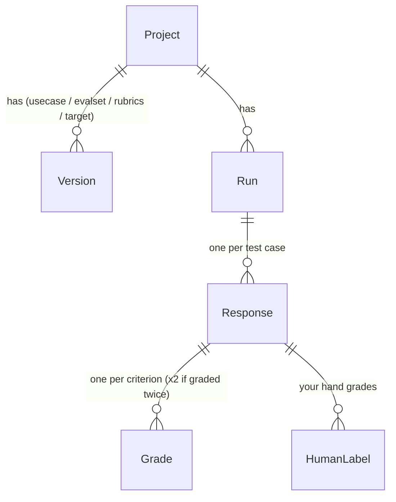

# Architecture

## Data model



| Object | What it holds | Versioned |
|---|---|---|
| **Project** | slug, title, description | – |
| **UseCaseCard** | goal, users, input types, output format, quality dimensions (weighted), test categories, failure modes, must / must-not rules, out of scope | yes |
| **EvalSet** | list of **TestCase**: id, input (one message or a conversation), category, difficulty, type, expected behaviours, optional reference answer, optional context (e.g. order data) | yes |
| **RubricSet** | one **Rubric** per test case, each a list of **Criterion**: name, description, dimension, weight, scale (pass/fail or 1–4 with anchors), must-pass, and a code check or LLM judge | yes |
| **Target** | the system under test: `prompt` (system prompt + OpenAI or Claude model), `http` (endpoint + request/response mapping), `python` (function in another project), `offline` (file of answers) | yes |
| **Run** | the four versions used, judge model, status, estimated and actual cost, summary | – |
| **Response** | the target's answer for one test case, latency, tokens, cost, model, final score and pass/fail | – |
| **Grade** | one criterion's grade: score, pass/fail, short reasoning, evidence quote, code or LLM, attempt 1 or 2 | – |
| **HumanLabel** | your grade for one criterion of one response (for judge calibration) | – |

The code is in [`evalstudio/models.py`](../evalstudio/models.py) (objects) and
[`evalstudio/store.py`](../evalstudio/store.py) (tables).

**Scoring (Milestone 4).** A test case's score is the weighted average of its criteria, each
normalised to 0–1 (pass = 1, fail = 0; on the 1–4 scale, 1 → 0, 4 → 1). A case passes if its
score reaches the pass mark (default 80%, `EVALSTUDIO_PASS_MARK`) and **no must-pass criterion
failed**. A criterion with both a code check and the LLM judge passes only if both pass.

## Project structure

```
eval-studio/
  evalstudio/
    models.py        the data model
    store.py         SQLite storage and versioning
    bundle.py        import / export of YAML or JSON project folders
    library.py       the library of quality dimensions
    config.py        settings from .env (provider and model per role)
    llm.py           one function to call OpenAI or Anthropic, with structured JSON output
    cli.py           the `evalstudio` command
    web/             FastAPI app, templates, CSS
    intake.py        step 1: clarifying questions and the use-case card
    generate.py      step 2: coverage plan, test-case generation, near-duplicate check
    importers.py     import test cases from Markdown, CSV, JSON or YAML
    rubrics.py       step 3: common and per-case criteria
    checks.py        the code-check library
    ai.py            one structured model call per role, with cost logging
    prompts/         the system prompts, as Markdown
    adapters.py      step 4: the prompt, http, python and offline targets
    grading.py       step 5: code checks + the LLM judge, and the scoring maths
    runner.py        steps 4-5 together: canary, fail-fast, spending cap, run summary
    estimate.py      cost estimates for --dry-run and the cap
    (later) report.py, calibrate.py, improve.py
  examples/
    support-email/   the public demo project (a bundle)
  tests/
  docs/
  data/              your projects and runs (gitignored)
```

## Bundle format

A project folder that can live in any repo:

```
support-email/
  project.yaml          slug, title, description
  usecase.yaml          the use-case card
  evalset.yaml          test cases
  rubrics.yaml          rubrics
  target.yaml           target config; a prompt target can point at a .md file:
  system_prompt_v1.md     system_prompt_file: system_prompt_v1.md
```

Any of the YAML files can be `.json` instead. Every file starts with `format: evalstudio/v1`.
